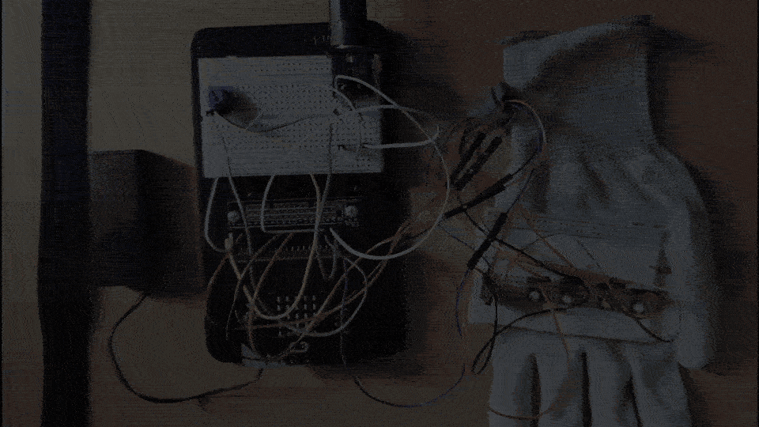
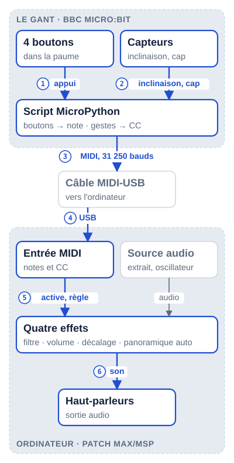

[English](README.md) · **Français**

# MIDI Hand

**Un gant qui joue des effets audio.** Quatre boutons dans la paume activent des effets dans Max/MSP ; l'inclinaison du bras et le cap de la boussole, lus par une carte BBC micro:bit, les règlent.

*Vraies prises de la démonstration de 2021. [Vidéo complète avec le son (2 min)](https://drive.google.com/file/d/1qyNxkPGdsj8i7iHvZa6W6IYRKT5G1GRB/view)*

## Utilisation

- **A · Filtre.** Le cap de la boussole règle la coupure et la résonance du passe-bas ; un réglage de sensibilité ignore les petits tremblements du bras.
- **B · Volume.** Lever ou baisser le bras monte ou baisse le volume.
- **C · Fréquence.** La même inclinaison change la hauteur de l'oscillateur du patch.
- **D · Panoramique.** Tourner le poignet règle la vitesse du balayage gauche-droite.
- **Combinaisons.** Les valeurs des boutons (1, 2, 6, 10) s'additionnent en une seule note MIDI : le patch lit toute combinaison sur un seul canal.

## Architecture

## État

- **Contexte.** Module *Interfacing for Audio and Music*, MSc Audio and Music Technology, université de York, 2021.
- **Matériel.** Carte BBC micro:bit sur carte de prototypage, 4 boutons, potentiomètre, piles, gant, câble MIDI–USB.
- **Code.** `MIDI_Hand_Python_script.py` (MicroPython, tourne sur la micro:bit) et `MIDI_Hand_MAX_MSP_patch.maxpat` (Max/MSP).
- **Écart connu.** Le script calcule le décalage du potentiomètre qui recentre la boussole mais ne l'envoie pas ; le patch l'attend sur le CC 24.
- **Aujourd'hui.** Prototype d'étudiant, plus développé depuis 2021.

---

**Anthony Hunt** · [ingevision.cloud](https://ingevision.cloud/?p=midi-hand) · [LinkedIn](https://www.linkedin.com/in/anthony-hunt-3948a9196) · [GitHub](https://github.com/anthohunt)
