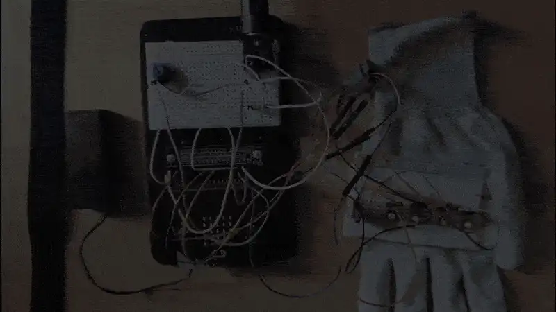
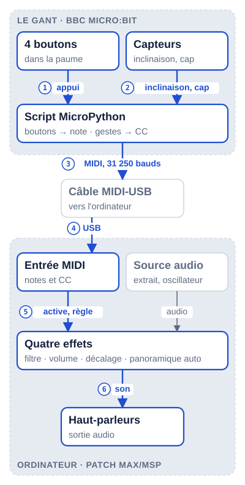

**English** · [Français](README.fr.md)

# MIDI Hand

**A glove that plays audio effects.** Holding one of four buttons on the palm turns an effect on in Max/MSP; the arm's tilt and compass heading, read by a BBC micro:bit, steer it.

French version

*[Full video with sound (1:59)](https://drive.google.com/file/d/1qyNxkPGdsj8i7iHvZa6W6IYRKT5G1GRB/view)*

## Using it

- **A · Filter.** The compass heading sets the low-pass cut-off; a dial in the patch sets the resonance and how much arm tremor is ignored.
- **B · Level.** Raising or lowering the arm raises or lowers the volume.
- **C · Frequency shift.** The same tilt moves the pitch of the patch's oscillator.
- **D · Auto-pan.** Rolling the wrist sets the speed of the left‑right sweep.
- **Combinations.** Button values (1, 2, 6, 10) add up into one MIDI note, so the patch reads any combination on one channel.

## Architecture

French version

## Status

- **Context.** *Interfacing for Audio and Music* module, MSc Audio and Music Technology, University of York, 2021; not developed since.
- **Hardware.** BBC micro:bit on a prototyping board, 4 buttons, potentiometer, battery pack, glove, MIDI‑USB cable.
- **Known gap.** The script computes the compass heading re-centred by the potentiometer but no longer sends it; the patch steers the filter only from that value (CC 24), so with this script the filter does not follow the compass. An earlier version of the script (March 2021) sent it.

---

**Anthony Hunt** · [ingevision.cloud](https://ingevision.cloud/?lang=en&p=midi-hand) · [LinkedIn](https://www.linkedin.com/in/anthony-hunt-3948a9196) · [GitHub](https://github.com/anthohunt)
