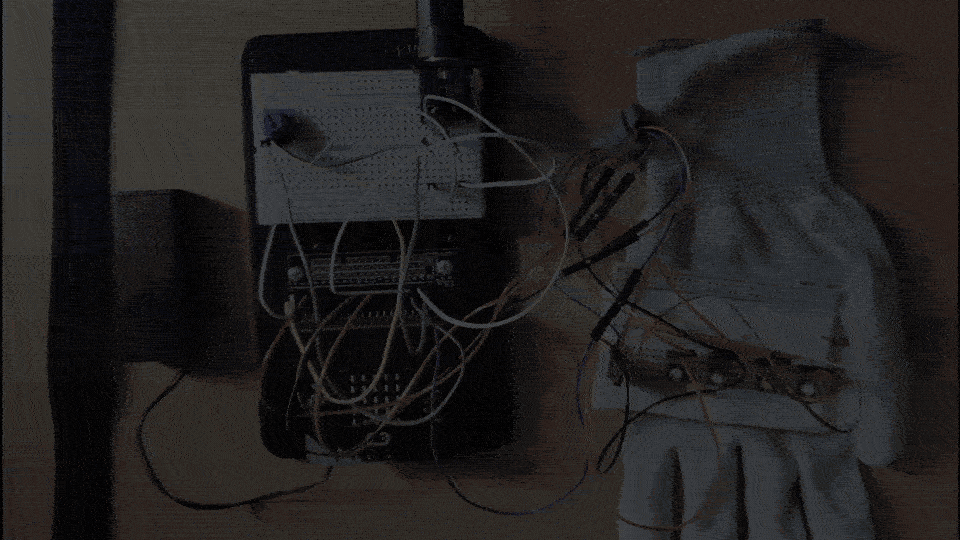
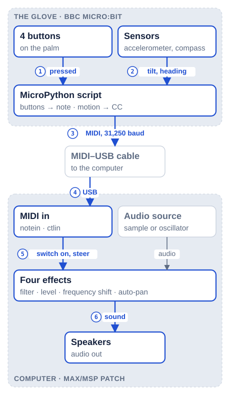

**English** · [Français](README.fr.md)

# MIDI Hand

**A glove that plays audio effects.** Four buttons on the palm switch effects on in Max/MSP; the arm's tilt and compass heading, read by a BBC micro:bit, steer them.

*Real takes from the 2021 demonstration. [Full video with sound (2:00)](https://drive.google.com/file/d/1qyNxkPGdsj8i7iHvZa6W6IYRKT5G1GRB/view)*

## Using it

- **A · Filter.** The compass heading sets the low-pass cut-off and resonance; a sensitivity setting ignores the arm's small tremors.
- **B · Level.** Raising or lowering the arm raises or lowers the volume.
- **C · Frequency shift.** The same tilt moves the pitch of the patch's oscillator.
- **D · Auto-pan.** Rolling the wrist sets the speed of the left-right sweep.
- **Combinations.** Button values (1, 2, 6, 10) add up into one MIDI note, so the patch reads any combination on one channel.

## Architecture

## Status

- **Context.** *Interfacing for Audio and Music* module, MSc Audio and Music Technology, University of York, 2021.
- **Hardware.** BBC micro:bit on a prototyping board, 4 buttons, potentiometer, battery pack, glove, MIDI–USB cable.
- **Code.** `MIDI_Hand_Python_script.py` (MicroPython, runs on the micro:bit) and `MIDI_Hand_MAX_MSP_patch.maxpat` (Max/MSP).
- **Known gap.** The script computes a potentiometer offset to re-centre the compass but does not send it; the patch expects it on CC 24.
- **Today.** Student prototype, not developed since 2021.

---

**Anthony Hunt** · [ingevision.cloud](https://ingevision.cloud/?lang=en&p=midi-hand) · [LinkedIn](https://www.linkedin.com/in/anthony-hunt-3948a9196) · [GitHub](https://github.com/anthohunt)
